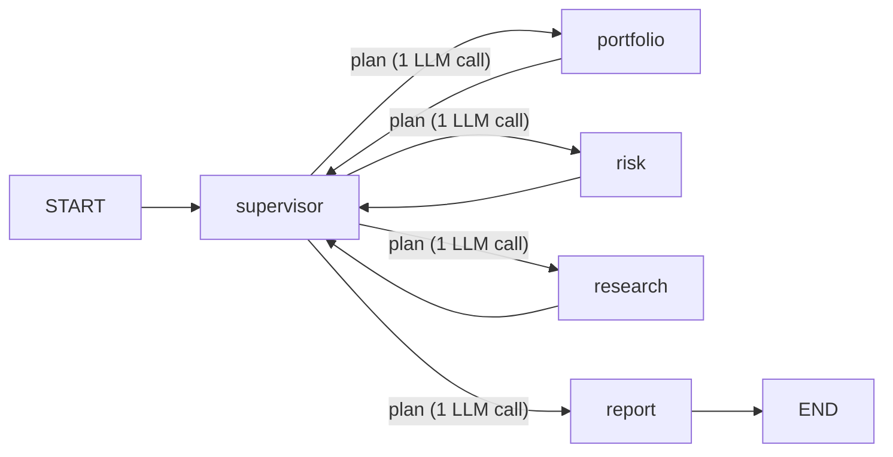

# FinSight: an agentic portfolio analyst

FinSight reads your portfolio from a CSV file (US stocks and ETFs) and answers questions about it
with a small team of AI agents built with **LangGraph**:

- a **Supervisor** plans which agents a question needs (one LLM call),
- a **Portfolio** agent and a **Risk** agent answer with numbers from plain Python tools,
- a **Research** agent reads SEC 10-K filings and recent web news, citing every source,
- a **Report** agent writes a structured report where every key number is traced to a tool.

It runs at **zero cost**: free Groq models, local embeddings, the free SEC and Tavily tiers. The
code refuses paid models unless you explicitly opt in.

> Status: Phases 0-4 are done (see [PLAN.md](PLAN.md)). Next: MCP tools, guardrails with
> human approval, a Streamlit UI, and evals.

## How it works



- **The LLM never does math.** Weights, P&L, volatility, Sharpe, beta, VaR, drawdown,
  concentration and correlations are computed in Python and tested with hand-checked answers.
- **Everything is traceable.** Key metrics must match the tool output they cite; research claims
  that cite an unknown source are dropped in code.
- **It never crashes on a flaky free model.** Each LLM step tries, retries once, then falls back.
- **It remembers.** Each step is saved to SQLite by thread id: follow-up questions work, and an
  interrupted run can be resumed.

More detail, in plain language: [docs/ARCHITECTURE.md](docs/ARCHITECTURE.md).

## Setup

You need Python 3.11+ and [uv](https://docs.astral.sh/uv/).

```bash
uv sync
cp .env.example .env     # then fill in your own keys
```

In `.env`:
- `GROQ_API_KEY`: free at console.groq.com (needed).
- `TAVILY_API_KEY`: free at tavily.com (optional: web news for research).
- `SEC_USER_AGENT`: your name and email, e.g. `Jane Doe jane@example.com` (needed for `ingest`;
  the SEC asks for it).
- `LANGSMITH_API_KEY`: optional tracing.

## Commands

```bash
# Ask about a portfolio
uv run finsight ask data/samples/balanced.csv "What's my sector exposure?"
uv run finsight ask data/samples/concentrated_risky.csv "How risky is my portfolio?" --thread t1
uv run finsight ask data/samples/concentrated_risky.csv "Which position drives that?" --thread t1   # follow-up
uv run finsight ask --thread t1 --show-state     # look at the saved state
uv run finsight ask --thread t1 --resume         # continue an interrupted run

# Research from 10-K filings + web news
uv run finsight ingest --from-samples            # or: finsight ingest NVDA AAPL
uv run finsight research "What are NVDA's main risks?" --ticker NVDA

# Tests (offline, free)
uv run pytest
```

Example output:

```
[supervisor] -> risk (llm): The question asks about the portfolio's risk level...
[risk] tools: get_risk_metrics({}), get_correlations({})
[supervisor] -> report (plan): all planned agents are done
[report] done

Route: supervisor -> risk -> report
LLM calls: 4

Key metrics:
  - Annualized volatility: 44.43 %   [source: get_risk_metrics]
  - Beta vs SPY: 2.03 ratio          [source: get_risk_metrics]
  - Largest position weight (TSLA): 91.75 %   [source: get_risk_metrics]
```

## Portfolio CSV format

```
ticker,quantity,avg_buy_price,buy_date,asset_type,currency
AAPL,25,184.90,2023-06-15,equity,USD
BND,120,69.40,,bond,USD
CASH,2500,1.00,,cash,USD
```

`ticker`, `quantity` and `avg_buy_price` are required. `asset_type` is one of
equity, etf, bond, crypto, cash (default equity). Cash rows use the dollar amount as quantity
and a price of 1.00. Sample files are in [data/samples/](data/samples/).

## Project layout

```
src/finsight/
  config.py          settings, get_llm (free models only), cost guard, rate limits
  schemas.py         all Pydantic models
  portfolio/         CSV loader, market data (yfinance + daily cache), math, PortfolioContext
  tools/             tools the agents call (portfolio/risk, 10-K + web search)
  rag/               SEC download, 10-K parsing and chunking, local embeddings + Chroma, search
  agents/            supervisor, portfolio, risk, research and report agents
  state.py           graph state + run context
  graph.py           the LangGraph graph, checkpoints, run and resume
  cli.py             finsight ask / ingest / research
tests/               offline tests (fake models, fake market data, fake embedder)
```

FinSight is an analysis tool, not a financial advisor. Nothing here is financial advice.
