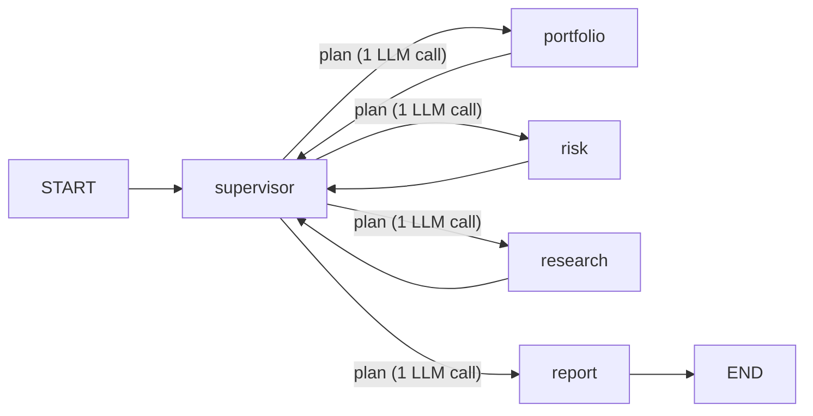

# FinSight: Agentic Portfolio Analyst

FinSight analyzes a stock/ETF portfolio from a CSV file using a team of LLM agents built with
**LangGraph**. A supervisor decides which specialists a question needs. A Portfolio agent and a
Risk agent answer with numbers from deterministic Python tools, and a Report agent writes a
structured report in which every headline number is traced to the tool call that produced it.

It runs at **zero cost**: all models are free-tier (Groq), embeddings will be local, and the code
refuses paid models unless you explicitly opt in.

> 🚧 Work in progress: phases 0–3 are done (see [PLAN.md](PLAN.md)). Research is a stub until
> Phase 4; MCP tools, guardrails/human approval and the Streamlit UI follow.

## Example
```
$ uv run python -m finsight.cli_graph data/samples/concentrated_risky.csv "How risky is my portfolio?" --thread demo1

[supervisor] -> risk      (llm) The user asks about portfolio risk.
[risk] tools: get_risk_metrics({}), get_correlations({}) | LLM calls: 2
[supervisor] -> report    (plan) all planned specialists done
[report] mode: structured | LLM calls: 1

Path: supervisor -> risk -> supervisor -> report
LLM calls this question: 4

Portfolio Risk Assessment
...
Key metrics:
  - Annualized Volatility: 44.43 %   [source: risk:get_risk_metrics]
  - Beta vs SPY: 2.03 ratio          [source: risk:get_risk_metrics]
  - Effective Number of Positions: 1.18 ratio   [source: risk:get_risk_metrics]
```

## How it works

- **The LLM never does math.** Weights, P&L, volatility, Sharpe, beta, VaR, drawdown, HHI and
  correlations are computed in plain Python ([tools/](src/finsight/tools/)) and covered by tests
  with hand-computed answers. Agents only choose which tools to call and explain the results.
- **One routing call per question.** The supervisor asks the LLM once which specialists are
  needed, then follows that plan without further LLM calls. A typical question takes 4 LLM calls
  (router, specialist ×2, report); one needing two specialists takes 6.
- **Specialists hand over findings, not chat logs.** Tool outputs are compact JSON with units in
  the key names (`weight_pct`, `market_value_usd`), keyed by a source id such as
  `risk:get_risk_metrics`. The report must cite these ids; metrics it can't trace are dropped.
- **It degrades instead of crashing.** If the router's output can't be parsed, the question goes
  straight to the report. If a specialist calls no tools, default data is fetched without an LLM.
  If the report's structured output fails, it retries, then falls back to plain text, then to a
  summary built without an LLM.
- **Persistence.** Every step is checkpointed to SQLite by `thread_id`: follow-up questions remember
  the conversation, interrupted runs can be resumed, and a resume refuses to mix market data from
  two different days.

## Quickstart (free)
Requires Python 3.11+ and [uv](https://docs.astral.sh/uv/).
```bash
uv sync                      # create .venv and install dependencies
cp .env.example .env         # add a free Groq API key (console.groq.com); LangSmith is optional
uv run pytest                # offline test suite (no API calls)

# Multi-agent graph
uv run python -m finsight.cli_graph data/samples/balanced.csv "What's my sector exposure?" --thread t1
uv run python -m finsight.cli_graph data/samples/balanced.csv "And how risky is it?" --thread t1   # follow-up
uv run python -m finsight.cli_graph --thread t1 --show-state     # inspect the saved checkpoint
uv run python -m finsight.cli_graph --thread t1 --resume         # continue an interrupted run

# Phase 2 single-agent baseline
uv run python -m finsight.cli data/samples/tech_heavy.csv "Which holding has lost the most money?"
```
Optional live tests: `uv run pytest -m network` (Yahoo Finance) and `uv run pytest -m llm` (free Groq models).

### Staying free
| What | Free source | Limit you'll actually hit |
|---|---|---|
| Router / agents / report | Groq free tier (`gpt-oss-20b`, `qwen3.8-27b`, `gpt-oss-120b`) | 8,000 tokens/min per model |
| Market data | Yahoo Finance via `yfinance` | Cached per day on disk (`data/cache/market/`) |
| Tracing (optional) | LangSmith free plan | n/a |

A request and token rate limiter slows calls down before Groq would reject them. Setting
`FINSIGHT_LLM_CACHE=true` replays identical LLM calls from disk while developing. OpenRouter models
are accepted only with a `:free` id unless `FINSIGHT_ALLOW_PAID=true`. All settings are listed in
[.env.example](.env.example).

## Portfolio CSV format
```
ticker,quantity,avg_buy_price,buy_date,asset_type,currency
AAPL,25,184.90,2023-06-15,equity,USD
CASH,2500,1.00,,cash,USD
```
Required: `ticker`, `quantity`, `avg_buy_price`. `asset_type` ∈ equity|etf|bond|crypto|cash (default
equity). USD only. Cash rows use `avg_buy_price` 1.00 with the dollar amount as `quantity`. Every
invalid row is reported at once, with its line number. Samples are in [data/samples/](data/samples/).

## Project layout
```
src/finsight/
  tools/        deterministic math (portfolio_math, risk_math) + market data and its cache
  agents/       tool wrappers, supervisor, portfolio/risk specialists, research (stub), report
  schemas/      Pydantic models: holdings, metrics, findings, report
  config.py     settings, get_llm(role), cost guard
  llm_limits.py free-tier rate limiter, token ledger, SQLite LLM cache
  context.py    PortfolioContext: CSV + market data loaded once, injected into tools
  state.py      graph state and reducers
  graph.py      LangGraph wiring, SQLite checkpoints, run/resume
tests/          offline suite with a scripted fake LLM
```

## Privacy
Questions and tool outputs (including your holdings) are sent to Groq to generate answers and,
if `LANGSMITH_TRACING=true`, to LangSmith. Use the sample portfolios, or turn tracing off, if
that matters for your data. `.env` and all local caches and checkpoints are git-ignored.

## Limitations
- US stocks/ETFs in USD only. P&L is price-only (dividends received are not included).
- Risk metrics assume today's weights were held over the whole lookback period (1 year by default).
- Reports can still pair correct numbers incorrectly in prose. Full number-consistency and
  grounding guardrails are planned for Phase 6.
- This is an analysis tool, not financial advice.

## Docs
- [PLAN.md](PLAN.md): build phases and status
- [DECISIONS.md](DECISIONS.md): the architecture decision log (what was chosen and why)
